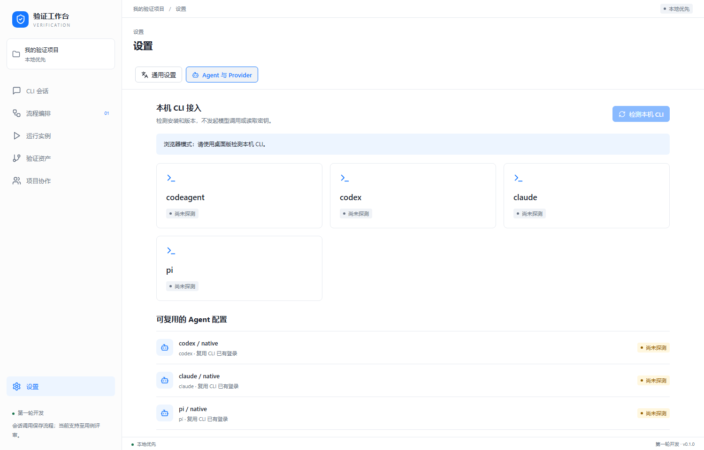

# 内部 CodeAgent CLI 接入

用户提供的信息：工具安装在另一个环境，交互命令为 `codeagent --dangerously-skip-permissions`；模型已经在 CodeAgent 内配置。因此 Profile 仅使用 native 协议，模型、Provider URL 和凭据引用必须为空，实际调用不传 `--model`。Codex / Claude / Pi 在设置中独立指定模型 ID，调用前检查模型是否填写。

Windows 扫描支持 `codeagent.exe`、`codeagent.cmd` 和 `codeagent.bat`。路径来源依次为进程 PATH、当前用户与系统注册表中的最新 PATH，以及常见用户级 CLI 安装目录。探测和实际调用使用同一搜索策略，子进程也获得合并后的 PATH，避免桌面进程持有旧 PATH。不会全盘扫描磁盘。

`CODEAGENT_CLI_PATH` 可以指定完整 exe / bat / cmd / js / mjs / cjs 入口，支持进程环境和 Windows 用户／系统环境配置。npm cmd 优先解析为受约束的 node_modules JS 入口，并寻找相邻 Node 或 PATH 中的 Node；自定义 cmd / bat 使用固定路径启动，由 Rust 的 Windows Command 实现处理批处理转义。用户题目通过标准输入传递，不拼接到 shell 命令中；不会运行任意 PowerShell profile、alias 或函数来探测。

版本探测只执行 `--version`，接受 `1.2605.05.02 (codeAgentCLI)` 等非空版本文本，不用 SemVer 正则限制内部版本号。超时为 5 秒；找到入口但启动失败、版本命令失败、无输出或超时会返回独立诊断，不表示工具未安装。扫描不会传 `--dangerously-skip-permissions`，超时回收批处理及其子进程。

自动流程调用时先通过有界 `--help` 检查非交互、stream-json、verbose、关闭工具与 MCP 等参数；满足所需参数后使用 Claude 风格事件归一化。启动参数仅表示可能兼容，终态事件、退出码和产物 Schema 仍须全部检查。

`--dangerously-skip-permissions` 仅用于用户确认的内部驱动调用；扫描不会附带该标志，其他驱动不继承它。设计节点关闭工具与 MCP；本轮不将它开放为局域网远程命令入口。

本机没有安装 CodeAgent，实测扫描结果为 missing。版本、参数和真实推理必须在安装环境回归；不能把 Codex 的实测结果当作 CodeAgent 的兼容认证。缺少所需非交互参数时返回 `cli_capability_unverified`，不将交互窗口文本猜测成成功产物。

## Windows 批处理回归

设置中的可复用 native 配置按 driver 关联同一次 CLI 安装探测结果及版本。CodeAgent 使用内部模型；其他 native 配置缺少模型时明确提示。Provider 配置的接口状态独立于本机 CLI 安装结果；版本探测不认证登录、模型授权或网络连通性。刷新失败会清除旧的成功结果，避免显示过期绿灯。

内部安装入口为带空格目录中的 `codeagent.bat`，此前仅匹配 exe / npm cmd 导致漏检。本地夹具在修改前复现解析失败；修复后执行真实 Windows batch，验证版本输出、受管探测、help 能力参数、MCP JSON、空 tools 参数及含中文和 shell 符号的标准输入原样传递。该夹具不是内部 CodeAgent 安装或模型推理认证。

可在启动工作台前指定入口（示例路径需替换为实际安装位置）：

```powershell
$env:CODEAGENT_CLI_PATH = 'C:\Example Tools\CodeAgentCLI\codeagent.bat'
& 'C:\Example Tools\Verification Workbench\verification-desktop.exe'
```

仅设置环境变量不能修复旧版软件对 bat 的缺失支持，应先更新到 0.1.3 或后续版本。

参考：[Rust Windows 参数与 batch 启动](https://doc.rust-lang.org/std/process/)、[Windows 注册表读取 API](https://learn.microsoft.com/en-us/windows/win32/api/winreg/nf-winreg-reggetvaluew)。


