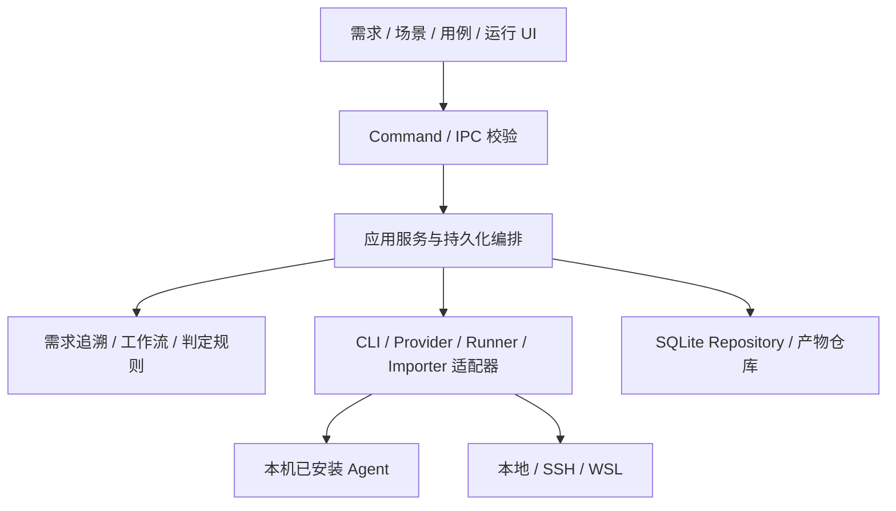

# 系统架构与技术选型

状态：建议方案。依据是本机 CLI 驱动、本地文件访问、Windows / WSL / SSH 执行与需求追溯；目前没有应用代码。

## 选型结论

建议 **Tauri 2 + React / TypeScript + Rust + SQLite**，采用本地优先的模块化单体。先用持久化任务状态机承载一条工作流，再发展为有类型的 DAG；暂不引入微服务、消息集群或独立通用 Agent 框架。

| 方案 | 本项目适配点 | 成本 / 使用条件 |
| --- | --- | --- |
| Tauri + React + Rust（推荐） | 桌面 UI 与系统执行能力分开；Rust 核心可复用于将来 Runner | 双语言与跨平台打包；必须先验证进程管理、WebView 和开发环境 |
| Electron + TypeScript | 单语言、Node 进程集成直接，适合熟悉 TS 的团队 | 需维护 Electron 权限边界与桌面发布；若 Rust 能力不足可改选 |
| Web + 本地 Runner | 多人协作和集中管理方便 | 首期增加登录、服务部署、连接与版本兼容成本 |
| 纯 CLI | 最快验证核心流程，可用于自动化 | 原文映射、场景树和用例评审不方便；适合作为核心的第二入口 |

Tauri 将 Rust 核心与 WebView 分在不同进程，适合把系统能力放在核心侧；这是选型依据之一，仍需验证工程成本。[官方进程模型](https://v2.tauri.app/concept/process-model/)

## 模块化边界



图中箭头表示调用与协作，外部实现通过领域定义的端口注入。Controller 不包含提示词和业务规则，领域层不引用具体 CLI、数据库驱动或 UI 框架。

| 模块 | 职责 | 不承担的职责 |
| --- | --- | --- |
| projects / documents | 项目、文档修订、可定位源片段 | 判断测试成功 |
| traceability | 原子需求、场景树、多对多映射、覆盖状态 | 自动认可 Agent 自报覆盖 |
| workflows | 定义、类型检查、运行状态、确认门禁 | 直接拼 CLI 命令或 SQL |
| agents | 角色契约、Driver 注册、事件归一与能力发现 | 承担最终通过规则 |
| providers | 连接配置、协议能力、密钥引用、诊断 | 把所有兼容 API 视为等价 |
| test-assets | 用例、模板、代码修订与结果解析协议 | 直接决定远程命令执行 |
| execution | 目标预检、工作区、进程、取消、证据收集 | 随意改变已审核脚本 |
| verdicts / actions | 确定性规则、分析建议、后续动作策略 | 无证据判 PASS、无限自修复 |
| persistence / audit | Repository、迁移、事件、操作记录 | 替业务模块修改状态规则 |

## 建议目录（未来创建）

```text
src/
  features/{projects,requirements,scenarios,cases,workflows,runs}/
  shared/{components,api,i18n}/
  styles/                         # 遵循现有 CSS 架构技能
src-tauri/src/
  commands/                       # 按功能拆分的入口
  services/                       # 应用用例与编排
  domain/{requirements,workflows,runs,verdicts}/
  ports/                          # AgentDriver、Repository、ExecutionTarget
  adapters/{agents,providers,execution,documents}/
  database/{repositories,migrations}/
  observability/
schemas/                          # 跨进程契约、产物与工作流 schema
workflows/                        # 产品内置的版本化定义
templates/                        # 内置模板 manifest 和资源
tests/{contracts,integration,fixtures}/
docs/
```

单个模块按用例继续拆分；不得将所有调度、进程处理或提示词堆入 `lib.rs`、`workflow_service.rs`。前端 Component → Hook / Store → API，禁止组件直接执行进程或数据库操作。

## 存储与持久化

SQLite 保存关系、索引、定义修订、事件序号、运行状态和审批；大日志、报告、截图在本机产物仓库，记录相对路径、媒体类型、长度和 SHA-256。运行快照固定工作流、输入、代码、模板、CLI 版本和配置摘要，不保存密钥。

采用事务同时提交节点状态与事件（需要派发时增加 outbox），通过事件序号向 UI 增量推送；大日志分块落盘、尾部显示和背压，禁止每个 token 都刷数据库。事件用于追踪，不把首版变成完整 event-sourcing 系统。

SQLite WAL 仅用于同机存储，不将数据库放到 SSH / SMB 共享目录；备份通过一致性快照完成。将来多人并发访问时由中心服务持有数据库连接，而非分发数据库文件。[SQLite WAL 限制](https://www.sqlite.org/wal.html)

## 进程与扩展策略

首版由 Rust 核心调度受管子进程。应用退出或崩溃后先将未完成节点标为待核实，不能承诺后台仍持续运行；恢复时依据本机进程记录或远程任务 manifest 对账。真正“关闭 UI 也持续运行”需要后续独立 Runner 服务。

扩展点先采用编译期适配器注册和受控声明式模板，不急于加载任意第三方二进制插件。新增 CLI 实现 `AgentDriver`，新增执行位置实现 `ExecutionTarget`；业务流程不增加散落的名称判断。

跨进程使用版本化 DTO，Rust 类型生成前端类型或由共同 schema 校验；禁止手工维护两份逐渐偏离的状态枚举。网络、多用户与集中队列只在实际需求出现时拆出，详见 [ADR](../adr/0001-local-first-modular-monolith.md)。
