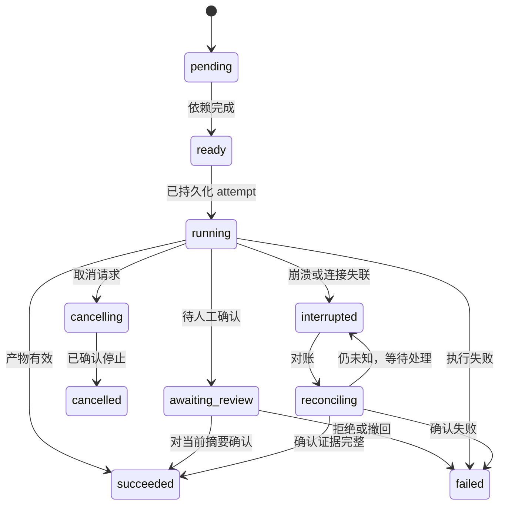

# 工作流引擎与自定义生成

状态：契约提案。首条内置流程为通用测试，产品支持通过相同模型保存自定义流程。

## 定义、修订、运行三者分离

- `WorkflowDefinition` 是身份；`WorkflowRevision` 是不可变的定义快照，包含 schema 版本、节点、依赖、绑定、策略和提示词引用。
- `WorkflowRun` 固定某个 revision 及本轮项目输入，不因用户编辑模板而改变历史。
- `NodeRun` 表示某次业务节点，`NodeAttempt` 表示一次实际执行；重试产生新 attempt，保留旧输出与证据。
- `ArtifactRevision` 是节点产物；结构有效、业务有效、人工确认是不同标记。
- `Approval` 绑定操作者、输入 / 输出 digest、授权范围和时间；上游变化后失效。

## 有界 DAG，而不是任意代码执行

首版节点类型建议为 `import`、`agent`、`human`、`validation`、`runner`、`evaluation`、`policy`。每类来自白名单注册器，声明输入 / 输出类型、所需能力、超时、重试和允许动作。

控制流保持 DAG；条件由有限结构化谓词描述，不执行 JavaScript / Python 表达式。补测、重试、修复循环由有最大次数的策略创建新的 attempt 或关联子运行，不允许随意回连成无界图。

边定义等待关系，输入绑定定义具体产物。编译阶段需验证引用节点为祖先、输出槽存在、类型一致，不能只检查 JSON 能解析。执行前固定模板与提示词版本，检查能力和授权覆盖。

## 由 Agent 生成并保存

1. 用户描述验证目标，系统提供节点目录、类型、已配置 Driver / 目标能力与参考流程。
2. 工作流生成角色产出 `WorkflowRevision` 候选和自然语言说明，描述输入、检查点、产物及失败策略。
3. 编译器进行结构、语义与能力校验，输出具体节点和字段错误。最多允许有限轮修正，超限后保存草稿与诊断。
4. 用户评审新增动作、执行位置、预算和阶段确认点，编辑步骤或参数。
5. 保存草稿；发布时生成不可变修订和内容 hash。复制、导入、导出均保留来源，未知版本不可直接启用。
6. 运行前绑定项目、Spec、CLI Profile、模板和执行目标，展示差异与执行计划。保存和发布定义都不会启动测试。

初期以列表 / 表单编辑即可，复杂画布后置。Agent 不能给自己增加新节点实现、关闭校验或提升权限；自定义代码节点需未来单独设计扩展机制。

## 两层校验

| 层次 | 检查 |
| --- | --- |
| JSON Schema | 字段类型、版本格式、枚举、节点基础结构、预算范围 |
| 编译与业务校验 | ID 唯一、无环、引用可达、类型对齐、入口完整、终点存在、节点实现存在 |
| 角色 / 策略校验 | 所需 Driver 能力、工具范围、环境能力、阶段审批、动作边界 |
| 运行输入校验 | 实际文件、凭据引用、模板、远端健康、内容 hash 与授权有效性 |

本目录的 [JSON 示例](../examples/general-testing.workflow.json)与[草案 Schema](../schemas/workflow-definition.schema.json)用于评审契约。Schema 无法表达全部语义；本轮没有实现生产编译器或运行时。

## 状态与恢复

`failed/cancelled` 节点若允许重新执行，以新 attempt 转入 ready；不能修改旧 attempt 终态。依赖失败时下游进入 `blocked`，条件不满足进入 `skipped`，两者均不能等价通过。运行结果从节点状态与业务判定共同汇总，不能因 DAG 运行完毕就 PASS。

节点控制状态与测试业务结果必须分离：执行器完整收集到一次失败断言，节点仍可 succeeded，但输出中的用例结果为 FAIL；运行异常且证据不完整时也可返回有效的 ERROR / INCONCLUSIVE 证据封套供判定。若进程控制、持久化等故障使节点无法返回有效封套，节点才 failed。引擎固定的运行终结器在 failed / blocked / cancelled 后保存终结摘要和恢复建议，不依赖成功链末尾的动作节点；这不是任意生成的 finally 代码。

节点状态、事件与派发意图在事务中记录；进程启动是外部副作用，不可能与数据库事务原子提交。使用启动 token、任务 manifest 与 attempt ID 对账；收到重复事件时去重，崩溃后的“已派发但未记录启动”先核实，不盲目重复执行。

SSH 任务已启动而连接断开时，先读远端任务状态与 manifest。无法确认是否执行过就保持未知，尤其不能对有副作用的测试直接重跑。外部动作默认按至少一次投递设计，以幂等键和后端支持减轻重复；不承诺端到端 exactly-once。

## 产物变更与审批

修改需求拆解、场景、用例或脚本均创建新 revision，从依赖图计算最小失效范围；下游重新生成不能覆盖已手改内容，先提供 diff。历史运行继续指向历史快照，新运行显式选择更新版本。

默认保留需求确认、覆盖检查、用例确认、执行计划确认。可配置可信模板的自动确认，但记录具体规则和摘要；用户查看用例是独立产品步骤，不能只在聊天里提示“已生成”就进入执行。

## 并发与资源

不同只读分析节点可并行；同一个工作区写操作、模板修改、目标资源有锁或配额。Agent 并发、target 并发、日志流量、上下文长度与运行预算分别限制。锁和 lease 有持有者与到期机制，过期先对账，不把抢到锁当作旧任务已停止。

默认重试只覆盖明确可重试的模型网络故障或无副作用操作。Schema 错误有限修正，业务断言失败进入判定而非自动重试；全链路总 deadline 覆盖 CLI 内部重试，避免多层重试放大。
