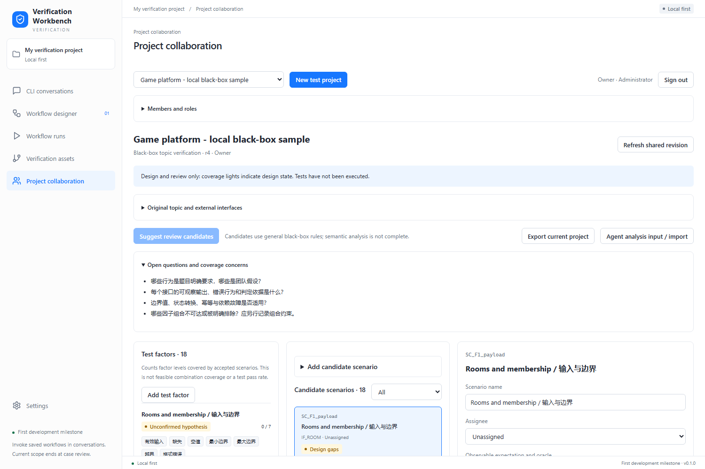

# 黑盒题目验证与团队协作

## 输入与输出

典型输入是“游戏对战平台系统详细说明”：子系统总体描述、功能规则、输入字段、预期输出、外部接口，以及题目提供的 Python 测试框架。**不需要被测系统源码**，也不能把框架代码当成被测实现。

目标输出为：可追溯的测试设计、测试因子与水平、场景组合、符合指定框架的 Python 脚本、实际执行证据、候选缺陷及复现步骤。界面覆盖灯只表示设计状态，测试通过与缺陷确认另行记录。

## 分析与生成流程

| 阶段 | 产物与约束 |
| --- | --- |
| 文档分析 | 子系统 / 功能 / 接口 / 规则 ID、原文引用；事实与假设分开，未知错误码不能编造 |
| 测试设计 | 等价类、边界、决策表、状态转换、权限、重放、并发、外部依赖异常和跨子系统业务链 |
| 因子组合 | 因子、水平、适用范围、不可达组合与前置状态；先覆盖高风险规则，再扩展组合 |
| 框架适配 | 框架 SDK、初始化 / 清理、身份注入、调用方法、断言风格、依赖、执行入口与结果解析 |
| Python 生成 | 场景 ID → 测试方法 → 契约断言；使用提供的客户端，不读取目标源码、不自行换框架 |
| 执行与分析 | 记录输入、身份、状态、响应、断言差异、环境版本；请求错误单列为无法判定 |
| 缺陷评审 | 重现后再确认；按规则、入口与响应特征提供候选分组，不把失败数直接当作缺陷数 |

框架与执行通过 `ExecutionPort` 接口隔离。正式流程已支持单文件 `python-unittest-v1`、四次人工确认、本地 Python 进程、真实 HTTP 证据与报告策略。接入步骤见[本地 Python 工作流](../workflows/local-python-verification.md)；多文件 / pytest 与 SSH / WSL 尚未实现。

## 当前共享工作台

侧栏“项目协作”提供黑盒题目与多人协作两种项目模式；两种模式都可多人参与。服务端保存题目、接口、因子、场景、分工、讨论、评审和每个修订的完整快照。

- 可生成六类规则候选：输入边界、身份权限、前置状态、外部依赖、重试与并发。候选统一标记为假设，不能当作 Agent 已理解全部语义。
- 设计者可新增 / 修改因子与水平、添加场景、组合因子、补充预期并分配负责人。
- 评审者检查依据后接受或要求修改。缺少预期来源、关联接口、因子组合或负责人时不能接受。
- 修改场景使其评审失效；修改因子使引用它的场景评审失效。删除被引用的水平会被拒绝。
- 使用个人令牌识别成员；管理员、设计者、评审者、查看者由服务端授权。当前权限为工作区级，尚未实现逐项目隔离或企业 SSO。
- 客户端每 5 秒同步。写入必须携带修订号，旧版本返回 409；草稿保留供人工比较，暂不自动合并。

当前 Agent 协作方式是复制带 Schema 的分析提示词并导入 JSON。局域网服务不会代替成员启动 CLI 或执行 Python。CLI 会话和编排草稿仍是个人浏览器数据，不能误认为已在团队共享。



## 本地运行与局域网访问

需要 Node.js 24.20+；Python 基准需要 Python 3.11+，桌面 CLI 驱动需要 Rust 构建环境。

```powershell
npm.cmd ci
npm.cmd run build
npm.cmd run serve:lan -- --host 0.0.0.0 --port 4317
```

本机访问 `http://127.0.0.1:4317`；同网段成员访问服务启动时打印的 `http://主机IP:4317`。进入“项目协作”，使用管理员创建的个人令牌登录。首次空数据库启动会在终端显示管理员令牌，后续启动不会重新生成。数据库默认位于 `.verification/team/team.db`，不得将 SQLite 文件直接放到网络共享盘供浏览器共同写入。

默认绑定回环地址；只有显式 `--host 0.0.0.0` 才监听局域网。若其他电脑连不上，检查路由与 Windows 防火墙是否允许该端口。本轮不自动修改防火墙。HTTP 模式适用于受控可信局域网；需要传输加密时由 HTTPS 反向代理提供。

服务只发布 `dist/index.html` 和构建资产；API 校验身份、角色、来源、输入大小与引用关系。JSON 校验器目前在浏览器动态编译，CSP 暂需 `unsafe-eval`；企业发布应改为构建时生成校验器后收紧。SQLite 调用同步执行，适用于当前小团队设计协作，长任务执行不进入该请求链。

## 验证边界

`npm run verify:blackbox` 使用账户 / 订单题目与受控缺陷目标，通过实际 HTTP 对比正常路径和增强计划。先运行 `cargo build -p agent-runtime --example turn --locked`，再执行 `npm run verify:game-agent -- --model 模型ID`，调用一次真实本机 Codex，根据游戏题目与给定框架生成 Python，再对缺陷与参考实现执行。该生成命令产生真实推理调用，不纳入普通 CI；`--reuse-script` 复用本地或归档脚本，不再调用模型，可以纳入 CI。

Python 基准有 AST 检查、允许的导入、请求预算、超时与本地目标约束，但不是操作系统沙箱。它只用于本地受控样例；任意用户脚本的企业执行隔离仍需后续实现。

## 产品参考

[ONES 测试管理](https://ones.cn/products/testcase)介绍了需求关联、用例组织、测试分工、缺陷流转、报表、权限和导入导出。本项目借鉴其协作闭环，当前不声称已达到这些功能的完整程度。

[黑盒测试示例文章](https://segmentfault.com/a/1190000046975975)作为用户给出的需求参考，启发等价类、边界、决策表、状态转换及业务流程维度；本文没有将其作为协议或框架实现依据。
