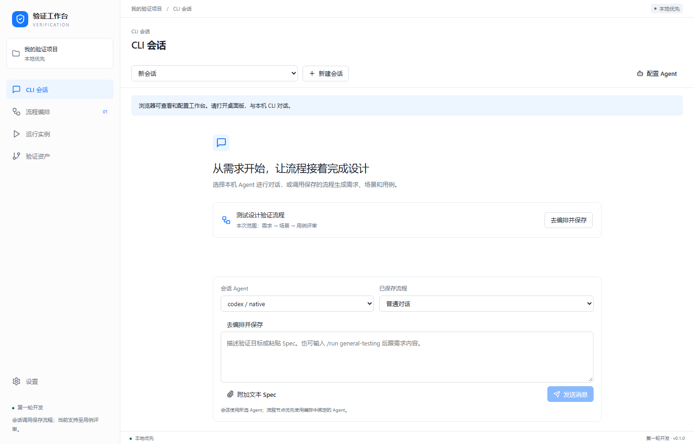
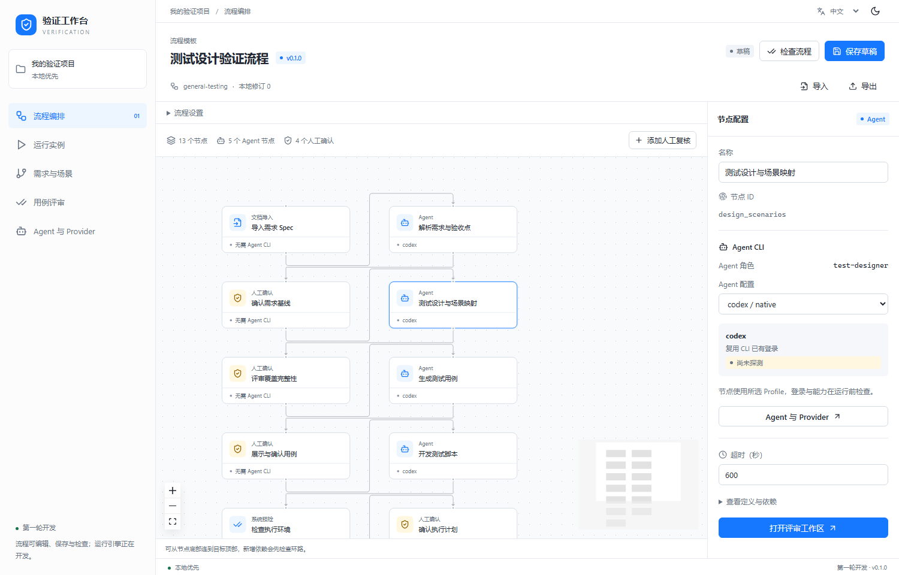
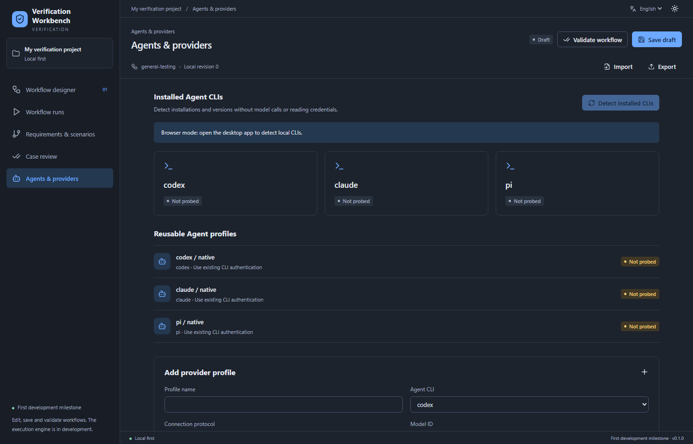

# 工作台界面与交互设计

状态：会话工作台开发版。默认进入应用内 CLI 会话，预置“测试设计验证流程”。已接入真实 CLI 适配与需求到用例评审状态机，实际账号推理尚待验证；脚本执行仍在后续阶段。详见[会话调用与设置](conversation-and-settings.md)。

## 信息架构

左侧项目导航管理 CLI 会话、流程编排、运行实例、验证资产。设置位于侧栏底部，包含通用设置与 Agent / Provider。需求与场景、用例作为验证资产的子页。全局配置与运行任务各有明确入口。

顶部显示项目、当前位置与本机调用状态；语言和主题移入设置。仅编排页展示定义检查、保存、导入导出与修订计数。草稿计数尚非不可变发布历史，但每次调用已固定保存定义与输入快照。

## 编排设计页

```text
┌──────────┬──────────────────────────────────────────┐
│ 项目导航 │ 流程名称 / 版本          检查 / 保存      │
│          ├────────────────────────┬─────────────────┤
│ 流程编排 │ 流程设置、添加复核     │ 选中节点配置    │
│ 运行实例 │                        │ 名称 / 角色     │
│ 需求场景 │ 可缩放、可拖动的画布   │ Agent Profile   │
│ 用例评审 │ 节点与依赖连线         │ 超时 / 输入输出 │
│ Agent    │ 缩略图 / 缩放控制      │ 打开工作区      │
└──────────┴────────────────────────┴─────────────────┘
```

点击节点配置角色、CLI Profile 和超时；Agent 节点展示实际绑定 Driver，人工 / 系统节点展示无需 CLI。拖动保存节点位置，从底部连接到目标顶部可新增依赖，环路即时拒绝。可添加人工复核分支；首轮不宣称已实现任意业务节点插件、任意节点删除或工作流生成 Agent。

流程支持结构 / 操作注册 / DAG / 引用 / 类型校验，导入失败不替换当前草稿。运行前的真实能力与鉴权认证尚未接入，定义检查通过不代表能够实际执行。

## 默认测试流程

| 用户理解的阶段 | 底层节点 | Agent CLI 接入 |
| --- | --- | --- |
| 需求输入与澄清 | 导入、解析、需求确认 | 需求解析节点 |
| 测试设计与覆盖评审 | 场景设计、覆盖确认 | 测试设计节点 |
| 用例生成与评审 | 生成、展示确认 | 用例生成节点 |
| 脚本开发 | 自实现 / 模板生成 | 用例开发节点 |
| 执行准备 | 目标预检、执行计划确认 | 系统和人工处理 |
| 测试执行 | 本地 / SSH / WSL 执行器 | 测试脚本执行器独立配置 |
| 分析与后续动作 | 证据判定、策略派发 | 判定分析节点；动作受策略约束 |

七个阶段细化为默认的 13 个节点，包含四个人工确认点。后续可折叠阶段显示；当前画布展示全部具体节点。

## Agent CLI 的三个界面入口

1. **设置 / Agent 与 Provider**：检测安装和版本，管理可复用 Profile。已有登录由 CLI 自行使用，自定义 Provider 保存协议、地址、模型和凭据引用。
2. **节点配置**：绑定 Profile，把测试设计角色交给 Codex、开发角色交给 Claude 或 Pi；任意组合都需要后续能力认证。
3. **CLI 会话**：驱动真实 CLI 对话或调用保存流程，展示文本、节点进度、确认和产物；运行记录可返回对应会话及调用快照。

工作流生成 Agent 也复用上述配置端口，属于后续的草稿生成能力。真实调度链是“节点 → Agent 服务 → Driver → CLI → 事件归一 / 产物校验”；前端不获得任意 shell 执行接口。

Rust 当前提供版本探测和原生 CLI 推理驱动。浏览器不具备本机能力，检测与发送按钮不可用；桌面通过 IPC 调用。自定义 Provider 表单目前仅保存元数据，“保存成功”不代表“连接成功”。

## 需求、场景与用例工作区

需求页采用三栏：左侧原文与修订，中间场景与覆盖义务，右侧当前映射和评审动作。点选场景查看来源；缺失场景先添加候选，人工确认后才计入正式覆盖。完整原文选区建链和真实导入将随产物服务实现。

设计覆盖、用例就绪和执行结果分开显示，均带文字和图标；不会因为覆盖转绿就显示执行通过。首轮用固定示例演示状态转换，并持续显示示例标记。

当前会话的真实产物可在会话和资产页查看；没有真实产物时显示当前会话空态，不填入示例或其他会话结果。资产页跟随会话，不使用跨任务下拉；从左侧列表或会话搜索切换设计。审批绑定输入摘要，协作补充、用例修订及覆盖失效规则见[增量协作与脚本覆盖](collaborative-contributions-and-script-coverage.md)。

## 视觉、国际化与适配

采用克制的蓝色主操作、浅灰画布、细边框与 Lucide 线性图标。桌面侧栏 260px、标题栏 38px、状态栏 28px；较窄窗口收为图标导航，保留可访问名称。多栏在小窗口下纵向排列，画布独立平移缩放。

主题颜色只在 token 层定义；foundation 统一控件，feature 文件组织各页，global 仅负责壳层。中英文消息 key 对齐，切换界面语言保留用户原文、节点身份和当前编辑状态。

## 首轮截图

最新会话首页：






