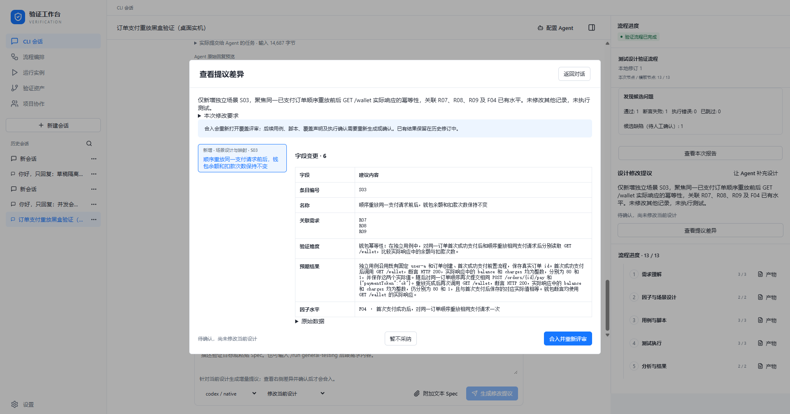

# 真实对话设计提议档案

日期：2026-11-04。真实 Windows Tauri WebView，经真实 Codex（请求模型 `gpt-6.1-sol`）生成两次增量提议。维护者通过实际会话、差异窗口及决策按钮操作，没有给 Agent 目标源码或手工注入候选场景。

- 第一次仅新增 S03，人工确认合入：场景 2 → 3，既有两个场景及四个因子不变，审批 4 → 1，回到覆盖评审。
- 第二次只修改 S03 标题，人工选择不采纳：原设计和唯一的合入历史保持，刷新保留结果。
- 原执行报告完整归档在只读历史，仍为 1 通过、1 失败；未对新增设计重新执行 Python。

`turns.json` 是两次实际公开任务与回复；`proposals.json` 是已应用和未采纳记录，含来源摘要、调用关联及修改前值。`design-before.json` / `design-after.json` 可对比验证无关条目未改动；审批及历史摘要分别保存。`files.json` 校验归档文件字节。这些记录不是可直接恢复执行授权的导入包。

[修改差异](update-diff.png) · [合入后状态](applied.png) · [只读旧报告](history.png) · [刷新后状态](final.png) · [详细验收方法与边界](../../../research/design-proposal-0.8.0-validation.md)
