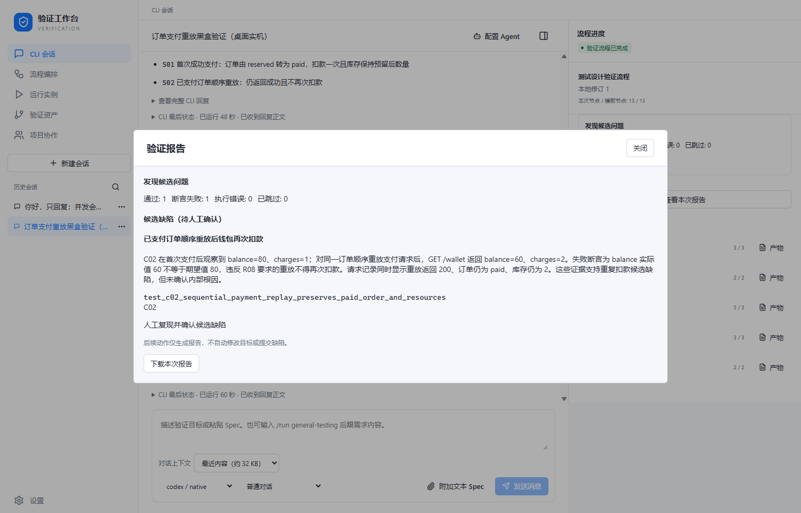

# 桌面实际操作生成档案

日期：2026-11-04。真实 Windows Tauri WebView、真实 Codex CLI；请求模型 `gpt-6.1-sol`。基础源码 `8ebcbfa`，场景校验失败后加载本轮映射规则修复，在同一任务点击重试；没有注入模拟 IPC、预制产物或改写业务存储。

从设置保存模型与可信 Python 框架，保存编排、输入本目录 Spec，经过四次实际界面确认，完整运行 13 个节点。生成 11 条需求、4 个因子、2 个场景、2 条用例和 2 个 Python 方法。Agent 仅收到题目、框架与正式任务指令，没有收到目标源码或缺陷标识。

- 含单一支付重放缺陷的受控目标：1 通过、1 断言失败、0 执行错误、0 跳过，26 条请求，1 个候选问题。
- 正确参考实现：同一脚本经原生执行器重新预检和执行，2 项通过、26 条请求；此对照没有另走一遍桌面会话。
- 原始脚本 SHA-256：`71897014b57fa8a03c6a3641557338c817b28cfd88ba8207e897d220c948d782`。

`turns.json` 保留所有实际公开请求与回复，包括首次无效场景和重试结果；`approvals.json` 保留四次界面确认。需求、设计、用例、脚本、证据、判定、报告分别归档。`files.json` 是脱敏后文件的 SHA-256 清单；原生证据中的内部摘要对应脱敏前原记录。导出省略原生会话 ID，并替换 Python 回溯中的设备路径；本目录不是可直接恢复授权的执行计划。

[因子界面](factors.png) · [覆盖矩阵](matrix.png) · [完整验收方法及边界](../../../research/desktop-live-validation-2026-11-04.md)

首次场景产物因 S01 引用的 F03 仅关联 R07 而被拒绝，未跳过校验。修复补充明确的映射规则；同一任务重试后 Agent 拆分首次支付与重放因子，进入评审。新增的精确失败反馈、刷新持久化和反馈容量限制另由回归测试验证。

这是受控题目的桌面验收记录，不能证明内部 CodeAgent、任意框架或真实业务系统全部可用。
