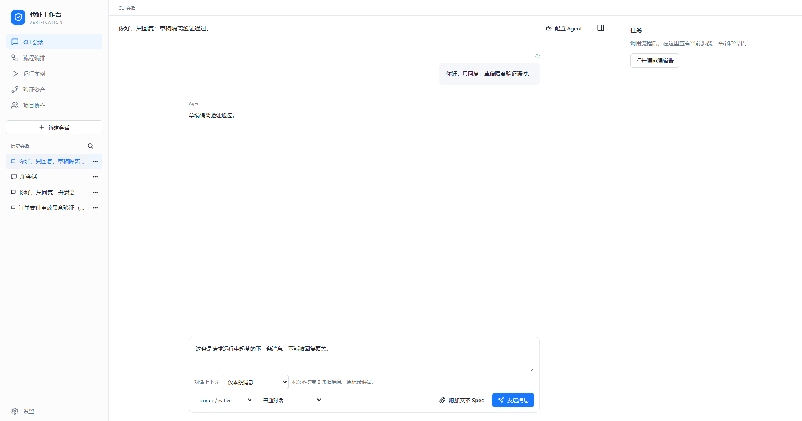

# 0.7.2 连续操作与覆盖语义验收

日期：2026-11-04。实现[易用性复盘](../design/workflow-usability-review-2026-11-04.md)中优先的两项，不将 P1/P2 标记为完成。

## 行为变化

- 草稿绑定个人会话，保存正文、Agent、对话/流程模式、框架、上下文方式及节点绑定选择。无会话时开始输入会建立草稿会话；切换、离开页面和刷新都保留。个人备份包含草稿，删除会话同时移除草稿，旧会话没有 draft 字段仍可加载。
- 接受提交时清除对应会话的已提交文本；拒绝提交保留输入。运行时允许起草及选择下一次配置，Enter 不会额外排队发送，原任务快照不变。异步回复不会用旧快照覆盖新草稿。
- 文本附件仍通过输入控件追加到正文。读取完成后使用原会话的最新草稿，保留读取期间新输入的文字，不写入其他会话，也不恢复已删除会话。来源材料独立管理仍待实现。
- 恢复的 Agent/框架不存在时显示不可用选项，要求重新选择，不静默换用另一个执行配置。
- 覆盖统计只计算明确关联当前需求的用例；经场景间接关联放在可展开列表中，不计入映射/执行计数。没有独立因子不自动算缺口。新增未运行和跳过的文字状态；声明、脚本映射和方法执行结果仍分开。

## 真实桌面验证

复用先前独立 WebView 目录的真实 Tauri 进程，通过回环 CDP 操作实际 UI，加载 0.7.2 生产前端。原生进程基线为 0.7.0，本轮 Rust 运行逻辑无变化；这不是 0.7.2 安装包或升级验收。没有注入模拟 IPC 或预制业务存储。

1. 新建 A，输入草稿并选择已保存流程、本地订单框架和节点 Agent 绑定。新建 B，输入不同草稿并选择仅本条上下文。切回 A、进入设置返回、刷新：草稿及选择均恢复；B 也独立恢复。
2. B 通过真实 Codex（请求模型 gpt-6.1-sol）发送一次短消息。接受后输入立即清空；请求运行中输入新的未发送内容，再按 Enter，没有第二次请求。切换到 A 后仍能查看 A 草稿。
3. Codex 实际回复“草稿隔离验证通过。”。B 的新草稿仍在，刷新仍保留；只读检查该会话只有一次用户提交及一次完整回复。
4. 使用真实文件输入控件追加 UTF-8 Spec，再补充文字；刷新后正文完整保留。
5. 打开此前真实生成的订单任务覆盖矩阵，11 条需求展示独立因子或“未关联独立因子”；筛选设计/脚本缺口为 0。原来 1 通过、1 失败的执行结果保持，不把无结构缺口等同于测试通过。

本轮没有重新生成完整订单流程。原订单模型产物与证据见[此前真实桌面验收](desktop-live-validation-2026-11-04.md)；此次验证其在新覆盖语义中的展示和持久化。

## 回归与边界

`npm run check` 通过，172 项单测、类型、格式、规模约束及生产构建通过。生产前端上的 36 项 Playwright 交互回归通过；其中延迟文件读取用离线可控夹具验证，真实桌面文件控件另外实测。离线测试不证明 CodeAgent 推理或安装升级可用。

新增契约覆盖草稿切换/刷新、后台回复隔离、拒绝提交、备份字段及无效导入；覆盖矩阵验证直接/间接关联、无独立因子、未运行、通过、断言失败、执行错误和跳过。方法通过不等于其中每一条需求的断言均已执行；逐断言追踪仍待开发。

[流程及框架恢复](images/usability-0.7.2/draft-restored.png) · [运行中起草](images/usability-0.7.2/draft-while-running.png) · [附件恢复](images/usability-0.7.2/attachment-restored.png) · [覆盖矩阵](images/usability-0.7.2/matrix-current.png) · [实际观察摘要](images/usability-0.7.2/result.json)
